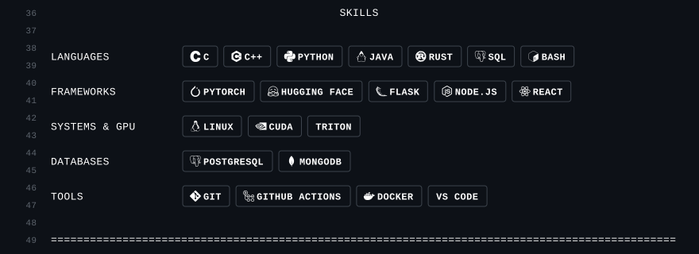

[`[ MK33 → ]`](https://github.com/dulguuntsatsralt-cell/Mk33) [`[ UNDEKLARED44 → ]`](https://github.com/dulguuntsatsralt-cell/undeklared44) [`[ WEBSITE → ]`](https://dulguuntsatsralt-cell.github.io) [`[ LINKEDIN → ]`](https://www.linkedin.com/in/nico-enkhtsatsral-96409b26b) [`[ EMAIL → ]`](mailto:de2318@nyu.edu)



<a href="https://github.com/dulguuntsatsralt-cell/Mk33"></a>

<a href="https://github.com/dulguuntsatsralt-cell/undeklared44"></a>


```text
LANGUAGES: MONGOLIAN · ENGLISH · CHINESE · A LITTLE GERMAN
STATUS: OPEN TO DATA SCIENCE AND AI/ML INTERNSHIPS, 2027
```
